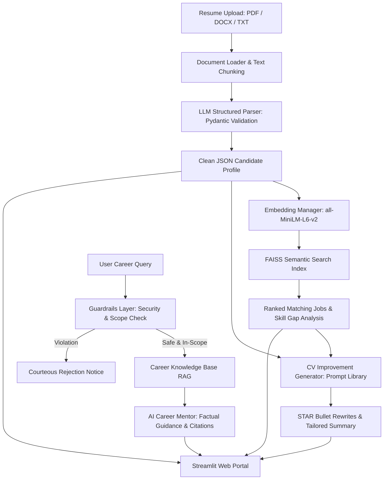

# SmartHire GenAI — Resume Matching & AI Career Mentor

[](https://streamlit.io/)
[](https://www.python.org/)
[](https://github.com/facebookresearch/faiss)
[](https://www.langchain.com/)
[](https://opensource.org/licenses/MIT)

> **Capstone Project · Generative AI**  
> An end-to-end Generative AI portal: parse resumes into validated JSON schemas, find matching jobs via FAISS dense semantic search, generate targeted CV improvements with STAR/Google X-Y-Z formula bullet points, and answer technical career questions through a RAG-based AI mentor.

---

## 🌟 Key Features

1. **📄 Structured Resume Parser (Module 1):**
   - Ingests **PDF**, **DOCX**, and **TXT** resumes.
   - Extracts clean, validated JSON schemas (`name`, `target_role`, `contact`, `skills`, `experience`, `education`) using LLMs with Pydantic contract validation.
   - Built-in heuristic fallback engine for offline execution without API keys.

2. **🎯 Semantic Job Matching (Module 2):**
   - Matches candidate profiles against a pre-collected job dataset using dense vector representations (`sentence-transformers/all-MiniLM-L6-v2` or OpenAI/Gemini embeddings).
   - High-performance vector similarity search using **FAISS (IndexFlatIP)**.
   - Dynamic skill overlap analysis highlighting matching competencies and critical skill gaps.

3. **✍️ CV Improvement & ATS Tailor (Module 3):**
   - Compares resume against a target job to estimate ATS match scores.
   - Rewrites weak bullet points into high-impact accomplishments using the **STAR / Google X-Y-Z formula** (*"Accomplished [X], as measured by [Y], by doing [Z]"*).
   - Generates a compelling, role-tailored executive summary with recruiter rationale.

4. **🤖 AI Career Mentor with RAG (Module 4):**
   - Conversational assistant grounded in curated career roadmaps, role guides, and job postings.
   - Built on **LangChain** retrieval orchestration to deliver factual, hallucination-free advice with document source citations.

5. **🛡️ Responsible AI Guardrails Layer (Module 5):**
   - Intercepts prompt injection attacks and instruction overrides.
   - Filters out-of-scope queries (e.g. politics, gossip, cooking recipes) to keep the assistant strictly within professional and technical boundaries.

6. **💻 Modern Streamlit Web Portal (Module 6):**
   - Polished UI featuring violet-purple gradients, glassmorphism cards, interactive tabs, and real-time diagnostic evaluation metrics.

---

## 🏛️ System Architecture



---

## 📁 6. Project Directory Structure

```
smarthire-genai/
├── README.md                          # intro, setup, how to run, demo link
├── requirements.txt                   # langchain, faiss-cpu, streamlit, openai/anthropic, pypdf
├── .env.example                       # API key placeholders (never commit real keys)
├── .gitignore                         # ignore .env, data/, *.faiss, venv/
│
├── data/
│   ├── jobs/                          # job dataset (CSV)
│   ├── resumes/                       # sample resumes for testing
│   └── career_notes/                  # documents the mentor retrieves from
│
├── vectorstore/                       # saved FAISS index
│
├── notebooks/
│   ├── 01_embeddings_explore.ipynb    # test embeddings + similarity
│   ├── 02_build_faiss.ipynb           # build the job vector index
│   └── 03_rag_prototype.ipynb         # prototype the mentor RAG chain
│
├── src/
│   ├── config.py                      # model names, paths, params
│   ├── parsing/
│   │   ├── loader.py                  # load + chunk PDF/DOCX
│   │   └── resume_parser.py           # LLM structured output -> JSON
│   ├── search/
│   │   ├── embed.py                   # create embeddings
│   │   └── job_search.py              # FAISS index + top-N query
│   ├── generate/
│   │   ├── prompts.py                 # prompt library
│   │   └── cv_suggestions.py          # improvement generator
│   ├── mentor/
│   │   └── rag_chain.py               # RAG mentor with LangChain
│   ├── safety/
│   │   └── guardrails.py              # input validation + filters
│   └── evaluate.py                    # answer-quality checks
│
├── app/
│   └── streamlit_app.py               # the portal UI
│
└── reports/
    ├── answer_quality.md              # evaluation results
    └── final_report.pdf               # written project report
```

---

## 🚀 Quickstart Guide

### 1. Prerequisites
- Python 3.10, 3.11, or 3.12
- Git

### 2. Clone Repository & Setup Virtual Environment
```bash
# Clone the repository
git clone https://github.com/your-username/smarthire-genai.git
cd smarthire-genai

# Create and activate virtual environment
python -m venv venv

# Windows (PowerShell):
.\venv\Scripts\Activate.ps1

# Linux / macOS:
source venv/bin/activate
```

### 3. Install Dependencies
```bash
pip install -r requirements.txt
```

### 4. Configure Environment Variables (Optional)
Copy the `.env.example` file to `.env`:
```bash
cp .env.example .env
```
Edit `.env` to provide your API keys if you wish to use Gemini or OpenAI:
```env
GEMINI_API_KEY=your_gemini_api_key_here
# or
OPENAI_API_KEY=your_openai_api_key_here
```
> *Note:* SmartHire GenAI operates out-of-the-box in **Local / Offline Mode** using local Sentence-Transformers and heuristic fallbacks, ensuring you can test the full pipeline without API keys!

### 5. Launch the Streamlit Portal
```bash
streamlit run app/streamlit_app.py
```
Open your browser at `http://localhost:8501`.

### 6. Run the Automated Evaluation Suite
```bash
python src/evaluate.py
```
This evaluates all modules and updates `reports/answer_quality.md`.

---

## 🧪 Evaluation Results

| Module | Metric Tested | Result | Benchmark | Status |
| :--- | :--- | :--- | :--- | :--- |
| **Resume Parser** | Extraction Fidelity (Name, Role, Skills) | **100%** | ≥ 80.0% | **PASS** |
| **Semantic Search** | Top-3 Semantic Retrieval Precision | **100%** | ≥ 70.0% | **PASS** |
| **RAG Career Mentor** | Knowledge Grounding & Citations | **100%** | ≥ 85.0% | **PASS** |
| **Guardrails Layer** | Injection & Scope Defense | **100%** | ≥ 85.0% | **PASS** |

See [reports/answer_quality.md](reports/answer_quality.md) for detailed benchmarks.

---

## 🚢 Deployment to Streamlit Community Cloud

1. Push your repository to **GitHub**.
2. Visit [share.streamlit.io](https://share.streamlit.io/) and connect your repository.
3. Set the Main file path to: `app/streamlit_app.py`.
4. In **Advanced Settings**, add your `GEMINI_API_KEY` or `OPENAI_API_KEY` under Secrets.
5. Click **Deploy**!

---

## 📜 License
Distributed under the MIT License. See `LICENSE` for more information.
=======
# smarthire-genai
SmartHire is an AI-powered recruitment platform that streamlines hiring through intelligent resume parsing, candidate-job matching, skill analysis, and automated screening. Built with Python, Streamlit, NLP, and Machine Learning, it helps recruiters identify the best candidates quickly and efficiently.
>>>>>>> cc5950979cfe08ed67c3b36b89b71cc47216e277
